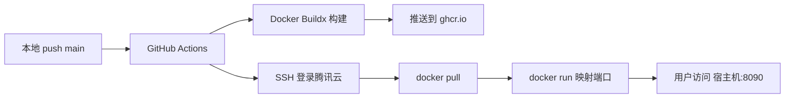

# Playground 腾讯云 Docker 自动部署 — 操作总结

本文档记录 `ten-admin` 仓库通过 GitHub Actions 将 **Playground** 构建为 Docker 镜像并部署到腾讯云服务器的完整流程，以及本次上线过程中涉及的本地 Git 与网络配置说明。

---

## 1. 项目背景与目标

| 项       | 说明                                                          |
| -------- | ------------------------------------------------------------- |
| 仓库     | [ten-clock/ten-admin](https://github.com/ten-clock/ten-admin) |
| 触发分支 | `main`                                                        |
| 部署产物 | Playground 前端静态站点（`pnpm run build:play`）              |
| 运行方式 | 容器内 Nginx 提供静态文件                                     |
| 镜像仓库 | GitHub Container Registry（`ghcr.io`）                        |

**业务目标**：推送 `main` 后自动构建镜像、在腾讯云服务器上拉取并重启容器，无需在服务器上手动手动构建。

---

## 2. 整体架构与数据流



1. **CI 构建**：`scripts/deploy/Dockerfile.playground` 多阶段构建（Node 编译 + Nginx 运行）。
2. **镜像标签**：`latest` 与当前 commit SHA。
3. **CD 部署**：`appleboy/ssh-action` 在目标机上 `pull` → `stop/rm` → `run`。

工作流文件：`.github/workflows/deploy-playground-docker.yml`。

---

## 3. GitHub 仓库配置

### 3.1 Secrets（Settings → Secrets and variables → Actions → Secrets）

| 名称 | 说明 |
| --- | --- |
| `DEPLOY_HOST` | 腾讯云服务器公网 IP 或域名 |
| `DEPLOY_USER` | SSH 用户名（如 `root`、`ubuntu`） |
| `DEPLOY_SSH_KEY` | SSH **私钥**全文（PEM），对应服务器已授权的公钥 |
| `GHCR_PULL_TOKEN` | （可选）私有 Package 拉取用 PAT，scope 含 `read:packages`；镜像公开时可省略 |

### 3.2 Variables（可选）

| 名称                    | 默认值 | 说明                                    |
| ----------------------- | ------ | --------------------------------------- |
| `DEPLOY_CONTAINER_PORT` | `8090` | **宿主机**对外端口，映射到容器内 `8080` |

### 3.3 工作流触发条件

- `push` 到 `main`
- 或手动 **workflow_dispatch**
- 仓库名须为 `ten-admin`
- 非 Dependabot；commit message 不含 `[skip ci]` 时才会在 push 时部署

---

## 4. 服务器侧要求

1. 已安装 **Docker**，部署用户能执行 `docker`（或配置 `sudo docker` / `usermod -aG docker`）。
2. **安全组 / 防火墙**放行 `DEPLOY_CONTAINER_PORT`（默认 **8090**）。
3. 服务器能访问 `ghcr.io` 拉取镜像（国内可能较慢，工作流 `command_timeout` 为 45 分钟）。
4. 若镜像私有：部署脚本会通过 `GHCR_PULL_TOKEN` 执行 `docker login ghcr.io`。

---

## 5. 端口说明（8080 vs 8090）

Docker 启动参数：`-p "${HOST_PORT}:8080"`（`HOST_PORT` 默认 8090）。

| 端口 | 位置 | 含义 |
| --- | --- | --- |
| **8080** | 容器内 | Nginx 监听端口（`scripts/deploy/nginx.conf` 中 `listen 8080`；`Dockerfile.playground` 中 `EXPOSE 8080`） |
| **8090** | 腾讯云宿主机 | 对外访问端口，浏览器访问：`http://<DEPLOY_HOST>:8090` |

修改对外端口：在 GitHub 设置变量 `DEPLOY_CONTAINER_PORT`，并同步放行安全组，**一般无需修改容器内 8080**。

---

## 6. 镜像与容器

| 项           | 值                                                       |
| ------------ | -------------------------------------------------------- |
| 容器名       | `ten-admin-playground`                                   |
| 镜像         | `ghcr.io/ten-clock/ten-admin:latest`（及 `:sha`）        |
| 重启策略     | `--restart unless-stopped`                               |
| 静态资源路径 | 容器内 `/usr/share/nginx/html`（来自 `playground/dist`） |

---

## 7. 日常发布流程

1. 在本地完成开发与提交。
2. 确保能 **push 到 `origin/main`**（见第 8 节网络说明）。
3. Push 后打开 GitHub **Actions** → **Deploy Playground Docker**，确认 job 成功。
4. 访问 `http://<服务器 IP>:8090`（或你配置的端口）验证页面。
5. 可在服务器上快速自检：

   ```bash
   docker ps --filter name=ten-admin-playground
   docker logs ten-admin-playground --tail 50
   curl -I http://127.0.0.1:8090
   ```

---

## 8. 本地 Git 与网络（本次排障记录）

在部分网络环境下直连 GitHub 会失败（SSH 22/443 被 reset、HTTPS `Recv failure`）。本次为 **本机用户级/仓库级** 调整，**未改动仓库内业务代码**。

### 8.1 本仓库 `origin`（HTTPS）

```text
https://github.com/ten-clock/ten-admin.git
```

（原为 `git@github.com:ten-clock/ten-admin.git`）

恢复 SSH 地址：

```bash
git remote set-url origin git@github.com:ten-clock/ten-admin.git
```

### 8.2 全局 Git：仅 GitHub 走本地代理

本机系统代理为 `127.0.0.1:7897`（如 Clash）时，已配置：

```bash
git config --global http.https://github.com.proxy http://127.0.0.1:7897
```

查看 / 删除：

```bash
git config --global --get http.https://github.com.proxy
git config --global --unset http.https://github.com.proxy
```

**注意**：关闭代理软件后应 unset，否则会连不上 `127.0.0.1:7897`。

### 8.3 SSH 配置（`%USERPROFILE%\.ssh\config`）

若仍使用 SSH 地址，可走 GitHub 443 端口：

```sshconfig
Host github.com
  HostName ssh.github.com
  Port 443
  User git
```

当前 `origin` 为 HTTPS 时，日常 push 主要依赖第 8.2 条代理配置；HTTPS 推送认证使用 **Git Credential Manager** 或 **PAT**。

---

## 9. 验收标准（本次部署）

- [ ] GitHub Actions 工作流 **Build image and deploy** 绿色通过
- [ ] 服务器上容器 `ten-admin-playground` 状态为 **Up**
- [ ] 公网 `http://<IP>:8090` 能打开 Playground 登录/工作台等页面
- [ ] 静态资源与 SPA 路由正常（刷新子路径不 404）

---

## 10. 常见问题

| 现象 | 可能原因 | 处理 |
| --- | --- | --- |
| Actions SSH 步骤失败 | `DEPLOY_*` 配置错误、安全组未放行 22 | 核对 Secrets、腾讯云 SSH |
| `docker pull` 超时 | 国内访问 ghcr 慢 | 重试、换时段，或配置镜像加速/代理 |
| 浏览器打不开 | 未放行 8090 | 腾讯云安全组入站规则 |
| 本地 `git push` reset | 未开代理或未配置 `http.https://github.com.proxy` | 开 Clash + 第 8.2 节配置 |
| 容器启动但空白页 | 构建失败或 dist 未打入镜像 | 查看 Actions 构建日志、`docker logs` |

---

## 11. 相关文件索引

| 文件 | 作用 |
| --- | --- |
| `.github/workflows/deploy-playground-docker.yml` | CI/CD 工作流 |
| `scripts/deploy/Dockerfile.playground` | Playground 镜像定义 |
| `scripts/deploy/nginx.conf` | 容器内 Nginx（监听 8080、SPA `try_files`） |

---

_文档版本：与首次 Playground 腾讯云 Docker 自动部署实践同步整理。_
